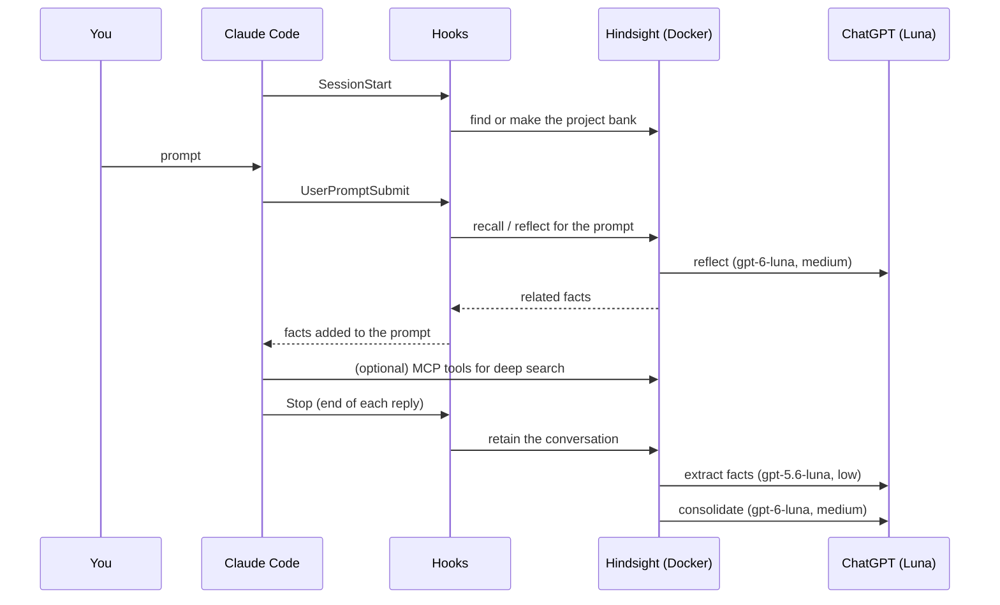
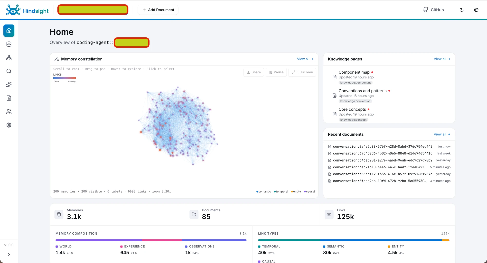
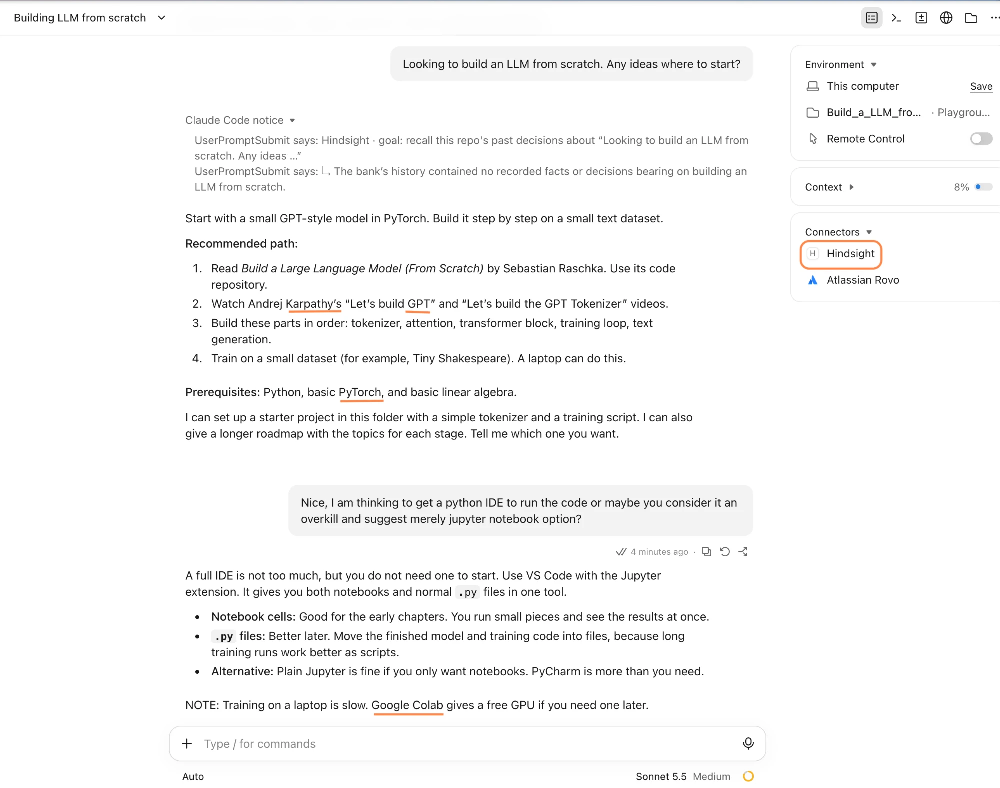
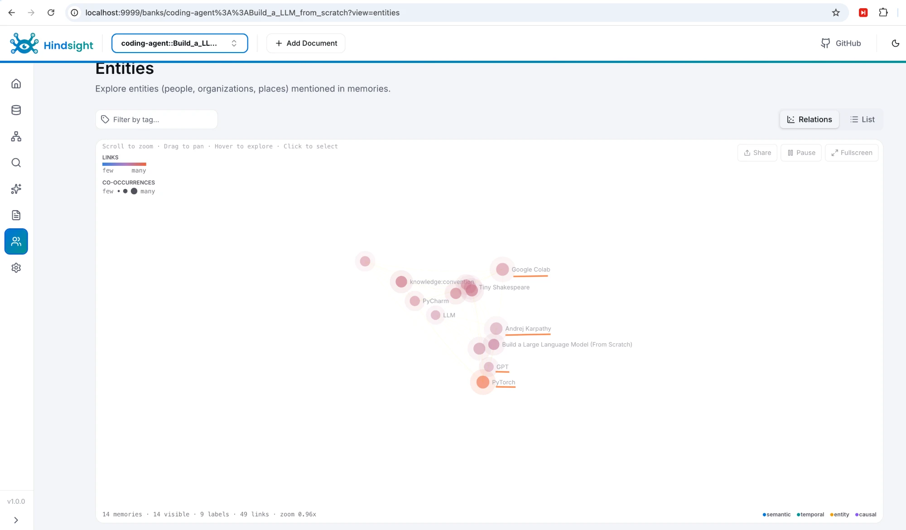
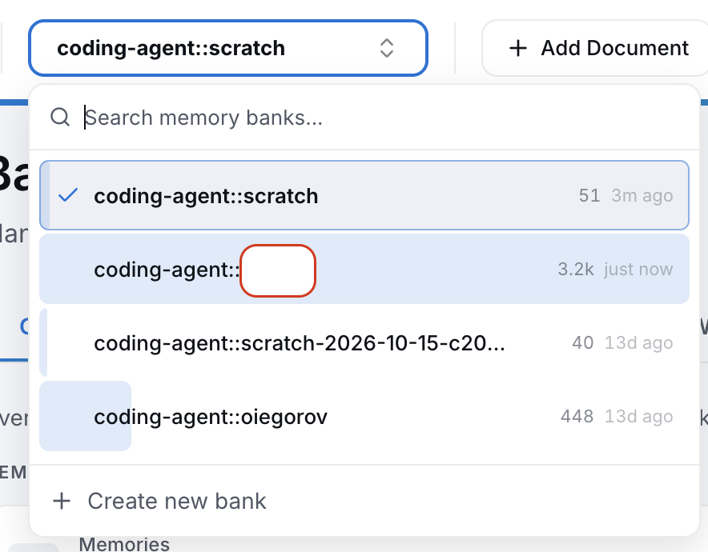
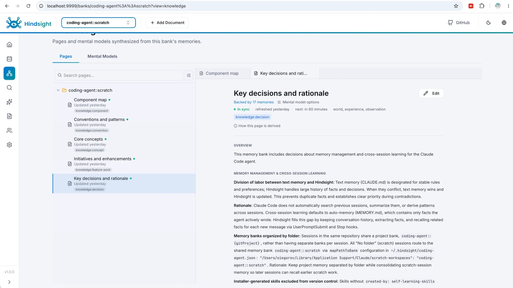
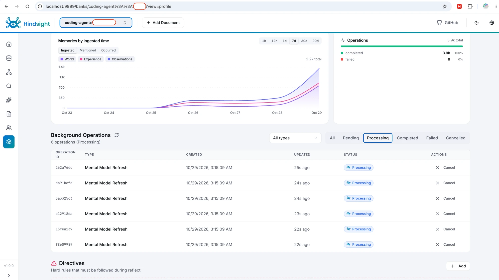
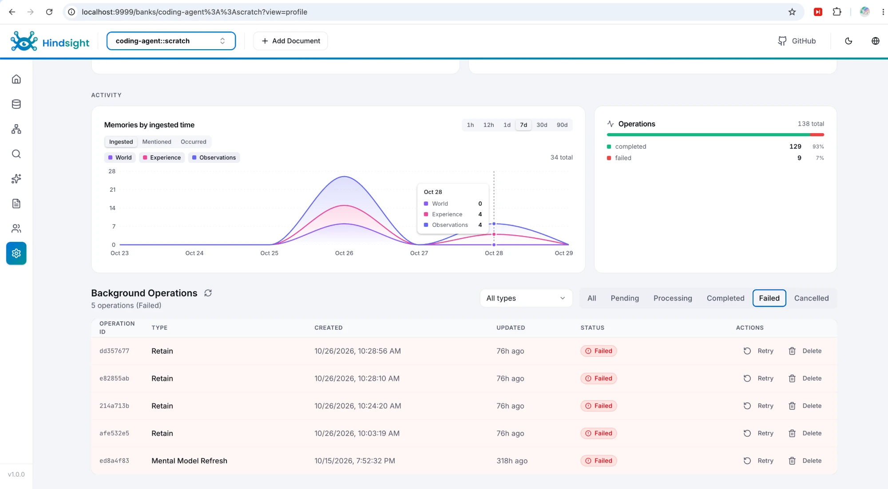

# Hindsight memory for Claude Code on a Mac (Docker + Codex)

**What it is:** a local [Hindsight](https://hindsight.vectorize.io) memory server in Docker. Claude Code connects to it through hooks, an MCP connector and a skill.

**The problem:** Claude Code does not read your old sessions. Each new session starts without your past decisions, issues and reasons.

**What it does:** after each session, Hindsight extracts facts from the conversation. Before each prompt, it gives Claude the facts that are related to that prompt.

**Recommended setup:** Docker full image, bound to `127.0.0.1` only, with your ChatGPT subscription through the `openai-codex` provider. You need no API key.

**Platform:** I made and tested this setup on a Mac with Apple Silicon. The installation steps below are for macOS. For Linux or Windows, give [AGENTS.md](AGENTS.md) to your agent: it has the gates and the steps for each platform. See [Requirements](#requirements).

**Web UI:** <http://127.0.0.1:9999> (it opens `/dashboard`). **API:** <http://127.0.0.1:8888>.

**Shortest path:** do [Installation](#installation) steps 1–7, then start a new session (step 10). Or give this folder to your agent with this prompt:

```text
Read AGENTS.md in this folder and set up Hindsight for Claude Code on this computer. Examine the requirements first. Ask me before each step that needs my login.
```

The agent examines the requirements, asks you four questions (provider, shared bank, git backup, import), does the steps, and reports. [AGENTS.md](AGENTS.md) also covers an Anthropic API key in place of the ChatGPT subscription.

CAUTION: Hindsight sends each conversation to the LLM provider for fact extraction. Do not use it for sessions with secrets that must not leave the machine.

NOTE: The prose uses ASD-STE100 Simplified Technical English. Commands, file contents and identifiers stay as they are.

---

## Contents

- [Why hooks, not only the connector and the skill](#why-hooks-not-only-the-connector-and-the-skill)
- [Components](#components)
- [Files](#files)
- [Flow](#flow)
- [Models and reasoning effort (Codex Luna)](#models-and-reasoning-effort-codex-luna)
- [Requirements](#requirements)
- [Installation](#installation)
- [Tests](#tests)
- [Settings and maintenance](#settings-and-maintenance)
- [Troubleshooting](#troubleshooting)

## Why hooks, not only the connector and the skill

The MCP connector and the skill are **pull** tools. Claude uses them only when Claude decides to use them. Hooks are **push**: Claude Code runs them at each event, every time.

| Part | What it does | Limit |
|---|---|---|
| MCP connector | Gives Claude tools: `hindsight_reflect`, `hindsight_search_knowledge_pages`, `hindsight_ingest_document` and others. | Claude must decide to call a tool. Often it does not, because it does not know that memory has the answer. |
| Skill (`hindsight-coding-agent`) | Tells Claude how and when to use the tools. | A skill loads only when the request matches its description. It cannot save a conversation by itself. |
| Hooks | `SessionStart` prepares the bank. `UserPromptSubmit` adds related memory to each prompt. `Stop` saves the conversation. | Each prompt gets about 1–1.5k more tokens, also when memory does not help. |

Without hooks, nothing saves your sessions, so memory stays empty. Also, Claude does not get memory at the start of a task, which is when it needs memory most. The connector stays useful for deep searches on request, for example "why did we choose X".

## Components

| Component | Where | What it does |
|---|---|---|
| Hindsight server (image `hindsight:latest`, 1.0.x when this guide was written) | Docker container `hindsight` | Stores memory in PostgreSQL. Extracts facts, consolidates them and answers `reflect`. |
| Local models | Inside the image | Make embeddings (BGE small) and rerank results (MiniLM). No external calls. |
| LLM | ChatGPT subscription through `openai-codex` | Runs fact extraction, consolidation and `reflect`. |
| `hindsight-coding-agents` 0.8.x | `~/.hindsight/coding-agents/` | The runtime for the hooks and the MCP server. It updates itself once a day. |
| Hooks | `~/.claude/settings.json` | `SessionStart`, `UserPromptSubmit`, `Stop`. |
| MCP connector `hindsight` | Claude Code user scope | The memory tools for Claude. |
| Skill | `~/.claude/skills/hindsight-coding-agent/` | Usage guide for Claude. |

**Memory banks:** the folder where you start a session selects the bank. The bank name is `coding-agent::` plus the folder name:

| Session starts in | Bank |
|---|---|
| A git repo, for example `~/code/my-project` | `coding-agent::my-project`. All worktrees of the repo share it. |
| A folder that is not a git repo, for example `~/code/architecture-notes` | `coding-agent::architecture-notes` |
| A "No folder" session of the Claude desktop app | `coding-agent::scratch` (with installation step 8) |

To give a topic its own memory, make a folder for it and start the sessions there. A subfolder of a session does not change the bank, because the bank comes from the folder where the session starts.

## Files

```text
~/.hindsight/
├── docker-compose.yml        # the server: image, ports, models, mounts
├── hindsight.env             # provider settings (chmod 600); compose values override it
├── codex/                    # separate ChatGPT login for Hindsight (chmod 700)
│   └── auth.json
├── coding-agent.json         # hook settings: server URL, bank mapping
├── coding-agents/            # hook + MCP runtime (installer makes it)
└── backup/                   # copies made before each change
~/.claude/
├── settings.json             # the three hooks
└── skills/hindsight-coding-agent/SKILL.md   # installer makes it
Docker volume: hindsight-data # the memory database
```

Templates in this folder:

- [files/docker-compose.yml](files/docker-compose.yml) and [files/hindsight.env.example](files/hindsight.env.example): the recommended setup (ChatGPT through `openai-codex`)
- [files/docker-compose.anthropic.yml](files/docker-compose.anthropic.yml) and [files/hindsight.env.anthropic.example](files/hindsight.env.anthropic.example): the Anthropic API key setup
- [files/coding-agent.json](files/coding-agent.json): the hook settings with the shared `scratch` bank

## Flow



1. At session start, the hook finds the bank for the folder. It makes the bank if necessary.
2. At each prompt, the hook asks Hindsight for related memory and adds it to the prompt.
3. Claude can call the MCP tools for more detail.
4. At the end of each reply, the hook sends the conversation to Hindsight.
5. Hindsight extracts facts, merges them into observations, and refreshes the knowledge pages every hour when they are stale.

## Models and reasoning effort (Codex Luna)

Hindsight uses your ChatGPT subscription through the Codex login. It sends one model and one effort level for each job type.

| Job | Model | Effort | Why |
|---|---|---|---|
| Retain (fact extraction) | `gpt-5.6-luna` | `low` | It runs after every reply, so it has the most calls. In the Hindsight retain benchmark, Luna 5.6 on `low` is rank 1. |
| Consolidation | `gpt-6-luna` | `medium` | It merges facts into observations. It needs more judgment, but it has fewer calls. |
| Reflect | `gpt-6-luna` | `medium` | It writes the answer that Claude reads. |

**Effort levels for both Luna models:** `low`, `medium`, `high`, `xhigh`, `max`. If you set no level, the model uses `medium`.

**How to select a level:**
- Use `low` for jobs with many calls and a simple task, such as fact extraction.
- Use `medium` for jobs that need judgment, such as consolidation and reflect.
- Do not use `high` or above. Each job then uses more of your subscription quota and runs more slowly, for a small gain.

To see which models your account has, examine `~/.codex/models_cache.json` (the Codex CLI writes it).

WARNING: The `openai-codex` provider is for personal use only, as the ChatGPT terms say. Do not use it for a team server.

CAUTION: Give Hindsight its own Codex login (`~/.hindsight/codex`). Codex refresh tokens rotate and work only one time. If Hindsight and the Codex CLI share `~/.codex/auth.json`, one of them gets `refresh_token_reused` and stops.

## Requirements

### Tested setup

This setup works on this machine. All measured values come from it.

| Item | Value |
|---|---|
| Machine | MacBook Pro, Apple M5 Pro (18 cores), 24 GB RAM |
| OS | macOS 27.0.1 |
| Docker | Docker Desktop 29.8.2, Compose 5.5.1, Docker memory limit 16 GB, 9 CPUs |
| Container | `shm_size: 1g`; 1.5 GB RAM and about 3% CPU while idle |
| Disk | 3.5 GB image, 0.7 GB data (about 3,300 memories after 2 weeks of daily use) |
| Software | Hindsight server 1.0.0, `hindsight-coding-agents` 0.8.2, Node.js 26, Codex CLI 0.163, Claude Code (desktop app and CLI) |
| LLM | ChatGPT subscription through `openai-codex` (`gpt-5.6-luna`, `gpt-6-luna`) |

### Minimum and recommended (all platforms)

| Item | Minimum (hard gate) | Recommended |
|---|---|---|
| CPU | 64-bit x86-64 or ARM64, 4 cores | 8 cores or more |
| Host RAM | 8 GB | 16 GB or more |
| Docker memory limit | 4 GB | 6–8 GB |
| Shared memory for the container | `shm_size: 1g` | same |
| Free disk | 10 GB | 20 GB or more (the data grows about 1–2 GB per month, estimate) |
| Software | Docker with Compose v2, Node.js 20 or later, Python 3, curl, Claude Code; Codex CLI for the ChatGPT option | same |
| Account | ChatGPT Plus or Pro, or an Anthropic API key with credit | ChatGPT Pro, for more quota |
| Network | Outbound HTTPS; ports 8888 and 9999 free | same |

The Docker image has builds for `linux/amd64` and `linux/arm64`, so the full image runs on all the platforms below.

### Expected to work (not tested)

| Platform | Expected | What is different |
|---|---|---|
| Mac, Apple Silicon (M1 and later) | Works | Nothing. With 8 GB RAM, set the Docker limit to 4 GB and close other heavy apps. |
| Mac, Intel | Should work | Docker runs the `amd64` image. Fact extraction can be slower. |
| Linux, x86-64 or ARM64 | Should work | Docker Engine replaces Docker Desktop. Docker access needs the `docker` group. The container user is UID 1000, so the Codex login folder can need `chown`. |
| Windows 10 or 11 | Should work, with WSL2 | Use Docker Desktop with the WSL2 backend. Run Claude Code (CLI), Node, Codex and all commands in the WSL2 Linux shell, so that `~/.hindsight` is one path for all of them. |

NOTE: [AGENTS.md](AGENTS.md) examines these values before it changes anything. It stops below the minimum and warns below the recommended values.

## Installation

**Prerequisites:** Docker Desktop (running), Homebrew, Claude Code, Codex CLI (`codex --version`), a ChatGPT Plus or Pro account, about 10 GB of free disk. Ports `8888` and `9999` must be free. See [Requirements](#requirements) for the full list.

These steps use the ChatGPT subscription. For an Anthropic API key, see [Use Anthropic in place of ChatGPT](#settings-and-maintenance) and skip step 3.

1. Install Node.js (the hooks need it).

   ```bash
   brew install node
   ```

2. Make the folders.

   ```bash
   mkdir -p -m 700 ~/.hindsight/codex ~/.hindsight/backup
   ```

3. Log in to ChatGPT for Hindsight only. A browser window opens. Log in and approve.

   ```bash
   CODEX_HOME=~/.hindsight/codex codex login
   ```

   Expected: `Successfully logged in`, and the file `~/.hindsight/codex/auth.json` exists.

   

4. Copy the configuration files.

   ```bash
   cp files/docker-compose.yml ~/.hindsight/docker-compose.yml
   cp files/hindsight.env.example ~/.hindsight/hindsight.env && chmod 600 ~/.hindsight/hindsight.env
   ```

5. Make the data volume and start the server. The first start downloads about 3.5 GB.

   ```bash
   docker volume create hindsight-data
   ```

   ```bash
   cd ~/.hindsight && docker compose up -d
   ```

6. Examine the server. The first start takes some minutes. Repeat the command until it answers.

   ```bash
   curl -s http://127.0.0.1:8888/health
   ```

   Expected: `{"status":"healthy","database":"connected",...}`. Up to 2 minutes later, the log shows `Codex LLM verified: gpt-5.6-luna` and `Codex LLM verified: gpt-6-luna`:

   ```bash
   docker logs hindsight 2>&1 | grep "Codex LLM verified"
   ```

   Open <http://127.0.0.1:9999> in your browser.

   

   Select a bank in the list at the top left. The home page shows the memory graph, the knowledge pages, the last documents and the memory counts.

7. Connect Claude Code (hooks, MCP connector and skill in one command). Run it from a folder that is not a project, for example your scratchpad.

   ```bash
   cd "${TMPDIR:-/tmp}" && npx -y @vectorize-io/hindsight-coding-agents@0.8.2 install claude-code --server self-hosted --api-url http://127.0.0.1:8888
   ```

   Expected: `hooks merged into ~/.claude/settings.json`, `skill installed`, `MCP server registered`. The installer keeps your other hooks.

   NOTE: The runtime updates itself once a day. To stop this, add `"autoUpdate": false` to `~/.hindsight/coding-agent.json`.

8. (Optional) Send all "No folder" desktop sessions to one bank. Step 7 made `~/.hindsight/coding-agent.json`. Add the `mapPathToBank` key to it, as in [files/coding-agent.json](files/coding-agent.json), and keep the other keys. Replace `<you>` with your user name.

9. (Optional) If you keep `~/.claude` in git, add `/skills/hindsight-coding-agent/` to its `.gitignore`. That skill has example tokens such as `"apiToken": "personal-key"`, and they trigger secret scanners.

10. Start a new Claude Code session, in a project folder or with "No folder". The current session does not load the new hooks. The first reply shows a `Hindsight` banner with the bank name: `coding-agent::<project>` for a project, `coding-agent::scratch` for "No folder" (with step 8).

    

    The first prompt shows a "Claude Code notice" from the `UserPromptSubmit` hook. In a new folder, the bank has no memory yet, so the notice says that it found no facts. The **Connectors** list shows **Hindsight**.

    

    After the reply, the `Stop` hook saves the conversation. Hindsight then stores the names from the conversation as entities. Open the bank in the web UI and select **Entities** (the people icon) in the left bar to see them.

## Tests

| Test | Command | Expected |
|---|---|---|
| Server is up | `curl -s http://127.0.0.1:8888/health` | `"status":"healthy"` |
| Models | `docker logs hindsight 2>&1 \| grep -E "LLM \(\|Codex LLM verified"` | `reflect` and `consolidation` on `gpt-6-luna`, both models verified |
| Hooks | `grep -c "hindsight/coding-agents" ~/.claude/settings.json` | `3` or more |
| Connector | `claude mcp get hindsight` | `Status: ✔ Connected` |
| Memory works | Ask a new session a question about past work in the project | The answer starts with `🧠 From Hindsight memory` |



## Settings and maintenance

**Change a model or an effort level:**

1. Edit the `environment:` block in `~/.hindsight/docker-compose.yml`. Use `HINDSIGHT_API_<JOB>_LLM_MODEL` and `HINDSIGHT_API_<JOB>_LLM_REASONING_EFFORT`, where `<JOB>` is `RETAIN`, `CONSOLIDATION` or `REFLECT`.
2. Recreate the container. The memory stays in the volume.

   ```bash
   cd ~/.hindsight && docker compose up -d --force-recreate
   ```

NOTE: Docker reads the compose and env files only when it makes the container. A restart does not apply a change.

**Knowledge pages:** each project bank has about 5 pages: core concepts, component map, decisions, conventions, initiatives. They refresh every hour, but only when new memory makes them stale. Read them in the web UI.



A green dot and "In sync" show that the page is current. "next: in 60 minutes" shows the hourly schedule.

**Failed jobs:** the web UI shows them for each bank. A failed retain job is safe to retry. If a later job for the same document completed, delete the failed job.

Open a bank, then select the settings icon (the gear) in the left bar. The "Background Operations" list has a filter for each status.





**Logs:** `docker logs -f hindsight`.

**Use Anthropic in place of ChatGPT:** copy [files/docker-compose.anthropic.yml](files/docker-compose.anthropic.yml) to `~/.hindsight/docker-compose.yml` and [files/hindsight.env.anthropic.example](files/hindsight.env.anthropic.example) to `~/.hindsight/hindsight.env`. Paste a Console API key (`sk-ant-api03-…`) with credit after `HINDSIGHT_API_LLM_API_KEY=`. A subscription token (`sk-ant-oat01-…`) does not work. Recreate the container. The log then shows `Anthropic connection verified successfully`.

**Turn memory off for one session:** start Claude Code with `HINDSIGHT_DISABLED=true`. To keep a session out of memory, use `HINDSIGHT_RETAIN_SESSIONS=false`.

## Troubleshooting

| Symptom | Cause | Fix |
|---|---|---|
| Many failed retain jobs, `credit balance is too low` | Anthropic API key with no credit | Switch to `openai-codex`, then retry the latest failed job for each document. |
| `refresh_token_reused` | Hindsight and the Codex CLI share one login | Do the separate login (installation step 3) and mount `~/.hindsight/codex`. |
| Knowledge pages are days old | A failed refresh paused the hourly schedule | Refresh each page once from the web UI or the API. A successful refresh starts the schedule again. |
| A config change has no effect | The container was only restarted | Run `docker compose up -d --force-recreate`. |
| A "list everything" answer is short | One `reflect` call gives a summary, not a full list | Ask again with the items already found. Use `gh` or the tracker for complete lists. |
| New banks are not made; `reflect` fails with `could not resize shared memory segment … No space left on device` | The container has the 64 MB Docker default for shared memory | Set `shm_size: 1g` in the compose file, then `docker compose up -d --force-recreate`. |
| Port `8888` or `9999` in use | Another service | Change the left port in the compose file and `apiUrl` in `coding-agent.json`. |
| Linux: permission error on `/home/hindsight/.codex` | The container runs as UID 1000 and cannot write the login folder | Run `sudo chown -R 1000:$(id -g) ~/.hindsight/codex && sudo chmod -R u+rwX,g+rwX ~/.hindsight/codex`, then recreate the container. Repeat after each new Codex login. |
